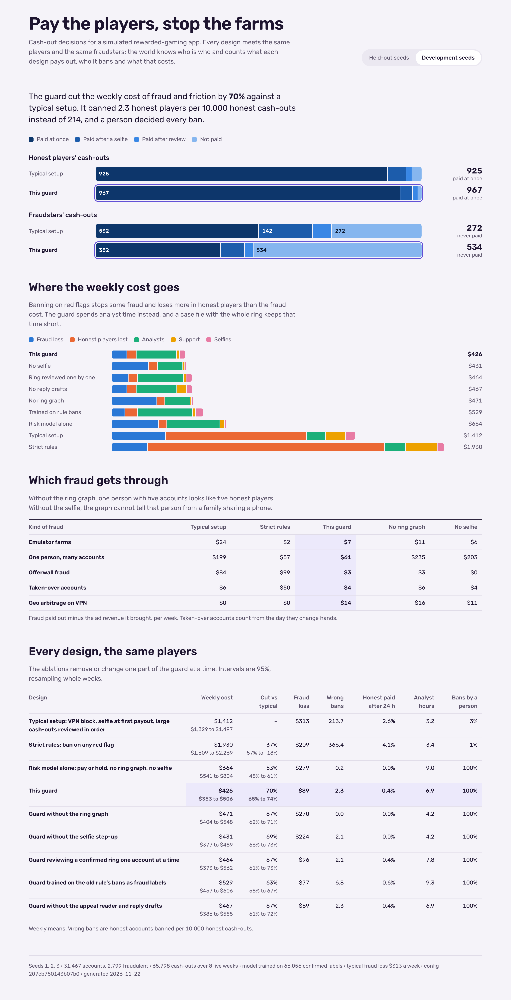

# cashout-fraud-guard

A fraud service for a rewarded mobile-gaming app, where players earn coins by playing and cash them out through PayPal or gift cards. Every cash-out is a payment, so fraud costs real money. Too much caution costs too: players who are banned or kept waiting leave and write the reviews that sink a rewards app's rating. The guard decides each cash-out request in Kotlin over gRPC, on GCP, with three possible outcomes: pay now, ask for a selfie, or hold for an analyst. **It never bans on its own: a person decides every ban.**

It does five things:

1. **Links accounts into rings.** It links accounts that share a phone's hardware fingerprint or a payout account into a ring (union-find, constant-time ring size and confirmed-fraud count). Emulator farms show up as rings of dozens. A family sharing one phone shows up as a ring of two or three.
2. **Scores each cash-out.** A small logistic model reads 16 signals: device attestation, VPN or datacenter share, the share of a network's accounts already confirmed as fraud, earning speed, how regular play times are, offer completion speed, a new PayPal account, and ring size and confirmed members. Its strongest signals become the reasons an analyst sees.
3. **Asks for a selfie when a phone or PayPal is shared.** A family has different faces; one person with five accounts has one face. A reused face, or a face that changed on the same account (a sold or taken-over account), waits for a person. Low risk is paid at once, middling risk is asked for a selfie, and high risk is held.
4. **Gives analysts a case file and the whole ring.** When an analyst confirms fraud, they decide the rest of that ring in the same review, from one case file. The other ring members cannot cash out while they wait.
5. **Reads appeals.** It reads a player's "why is my cash-out on hold?" in English, Spanish, Portuguese or German, using rules or Claude through a forced tool call with a closed schema. A claim moves the case up the queue only when it explains the hold and no hard evidence contradicts it. Support gets a reply draft in the player's language that never names a check.

## Results

The app, its players and its fraudsters are simulated. Each seed has about 10,500 accounts over 16 weeks. The first 8 weeks run a typical setup and produce the labels the model trains on; the last 8 weeks compare the designs.

- **Honest players.** Some honest players look suspicious: families sharing a phone and sometimes a PayPal, VPN users, travellers, old phones with weak attestation, people who changed phones.
- **Fraud.** Five kinds:
  - emulator farms on datacenter networks with scripted play;
  - multi-accounters: one person resetting a real phone to claim first-payout bonuses;
  - geo-arbitrage players on VPNs;
  - taken-over or sold accounts cashing out a hoarded balance on a new phone and a new PayPal;
  - offerwall fraud that advertisers claw back weeks later.
- **Analysts** have limited hours and make mistakes, fewer with a case file.
- **Cost.** It is measured in dollars a week: fraud paid out (after the ad revenue it brought), honest players lost to bans or waits (their remaining margin), analyst and support time, and selfie fees.

Every design meets the same players and the same luck: every random draw is keyed to the seed and the entity. Gates were set on the development seeds; the held-out seeds ran once.

<!-- results:start -->
_From the development seeds, run once; generated by `./gradlew :eval:readme`._

Against a typical setup (VPN block, selfie at the first payout, large cash-outs reviewed in order), the guard cut the weekly cost of fraud and friction by **70%** (95% interval 65% to 74%): the fraud loss fell from $313 to $89 a week, honest players wrongly banned fell from 213.7 to 2.3 per 10,000 honest cash-outs, and the share of honest cash-outs not paid within 24 hours went from 2.6% to 0.4%. Analysts spent 7 hours a week instead of 3, and every ban was decided by a person.

Seeds 1, 2, 3 · 31,467 accounts, 2,799 of them fraudulent · 65,798 live cash-outs over 8 weeks, 3,615 of them fraud · model trained on 66,056 labelled cash-outs from the 8 history weeks · config `207cb750143b07b0`. Intervals are 95%, resampling whole weeks. Money in US dollars per week.

| Design | Cost of fraud and friction | Fraud loss | Honest players lost | Analysts | Support | Selfies | Share of fraud money paid | Wrong bans per 10k honest cash-outs | Honest cash-outs paid after 24 h | Bans decided by a person |
|---|---|---|---|---|---|---|---|---|---|---|
| Typical setup: VPN block, selfie at first payout, large cash-outs reviewed in order | $1,412 ($1,329–$1,497) | $313 | $825 | $111 | $113 | $50 | 66% | 213.7 | 2.6% | 3% |
| Strict rules: ban on any red flag | $1,930 ($1,609–$2,269) | $209 | $1,383 | $120 | $180 | $38 | 61% | 366.4 | 4.1% | 1% |
| Risk model alone: pay or hold, no ring graph, no selfie | $664 ($541–$804) | $279 | $44 | $316 | $24 | $0 | 70% | 0.2 | 0.0% | 100% |
| **This guard** | $426 ($353–$506) | $89 | $51 | $240 | $14 | $32 | 43% | 2.3 | 0.4% | 100% |
| Guard without the ring graph | $471 ($404–$548) | $270 | $44 | $147 | $6 | $4 | 70% | 0.0 | 0.0% | 100% |
| Guard without the selfie step-up | $431 ($377–$489) | $224 | $51 | $149 | $8 | $0 | 67% | 2.1 | 0.0% | 100% |
| Guard reviewing a confirmed ring one account at a time | $464 ($373–$562) | $96 | $51 | $275 | $11 | $33 | 42% | 2.1 | 0.4% | 100% |
| Guard trained on the old rule's bans as fraud labels | $529 ($457–$606) | $77 | $71 | $324 | $15 | $42 | 35% | 6.8 | 0.6% | 100% |
| Guard without the appeal reader and reply drafts | $467 ($386–$555) | $89 | $51 | $240 | $54 | $32 | 43% | 2.3 | 0.4% | 100% |

The guard stopped 99.5% of emulator-farm accounts before their second paid cash-out, re-reviewed 16 honest players' appeals sooner because their claim explained the hold, and restored 5 wrongly blocked players.

**What the risk model learned** (first seed, standardised weights; positive raises risk):

| Signal | Weight |
|---|---|
| offers per offer hour | +0.63 |
| earn cents per minute | +0.63 |
| scripted timing | +0.17 |
| new payout account | +0.15 |
| ring confirmed fraud | +0.11 |
| ring size | +0.10 |
| amount | +0.09 |
| geo mismatch share | +0.07 |
| device failed attestation | +0.07 |
| vpn or datacenter share | +0.06 |
| accounts on payout account | +0.06 |
| account age days | +0.04 |
| device basic attestation | +0.03 |
| accounts on fingerprint | +0.03 |
| datacenter network fraud share | +0.02 |
| devices in window | +0.02 |

<!-- results:end -->

What the comparisons say:

- **Banning on red flags is the expensive mistake.** The strict rules and the typical setup's VPN block stop some fraud but ban far more honest players. The cost of those lost players is larger than the fraud.
- **A model trained on the old rule's bans learns the old rule back.** The guard trains only on what a person or a payment network confirmed. Training it on the VPN rule's bans as fraud labels sends honest VPN users to analysts and costs more every week.
- **The ring graph and the selfie work together.** Without the graph, multi-account players look like separate honest people and get paid. Without the selfie, the graph cannot tell them from families.
- **Deciding a ring in one review** is cheaper than reviewing each member when they next cash out.
- **Reply drafts are a support saving,** not a fraud one. They cut the time spent answering appeals.
- **What the guard lets through on purpose:** players on public VPNs who are earning from outside the paying market. Paying them costs less than banning every VPN user.



## Limits

- Players, fraud and analysts are simulated, and the rates in `config/world.json` are my assumptions, not JustPlay's or any app's data. The numbers show how the designs compare in this world, not what a real app would see. The simulation has about 10,500 accounts per seed, so weekly dollar amounts are small; the ratios are the result.
- Fraudsters here do not adapt to the guard beyond replacing banned farm accounts. Real farms learn which signals get them caught.
- The selfie is modelled as a vendor result (completed, live, a face template); no face matching is implemented here. Device attestation and IP reputation are inputs, not integrations.
- The service keeps the activity read model (logs, devices, the link graph) in memory, so it runs as one replica. Decisions, verdicts and the outbox are in MySQL and are safe across pods. Scaling out needs the read model in a shared store first.
- The outbox relay publishes through an interface; this build logs instead of calling Pub/Sub. The Terraform was validated, not applied, and no cluster ran the manifests.
- The Claude appeal reader is tested against a stub of the Messages API, not against the live model. The bundled reader is rules.

## Run it

```bash
./gradlew build                  # Kotlin 2.0, JDK 21: tests, including the service against MySQL 8.4 (Docker needed)
./gradlew :eval:evaluate         # development seeds -> reports/dev.json
./gradlew :eval:gate             # fails if the guard misses a gate in config/gates.json
./gradlew :eval:readme           # regenerates REPORT.md and the block above
./gradlew :eval:exportModel      # writes models/risk-model.json, the model the service loads
./gradlew :service:run           # gRPC on :50051 (JDBC_URL, DB_USER, DB_PASSWORD; ANTHROPIC_API_KEY optional)
cd web && npm ci && npm run dev  # the analyst dashboard over reports/
```

`./gradlew :eval:heldout` runs the held-out seeds and writes `reports/heldout.lock`; it refuses to run again.

### gRPC

| Call | Who calls it | What it does |
|---|---|---|
| `RecordActivity` | activity topic consumer | adds a day of play, the device and the network to the read model and the link graph |
| `Check` | payout backend | decides a cash-out once per `request_id`: `PAY`, `STEP_UP`, `HOLD` (or `BLOCK` for an account a person confirmed); a retry gets the decision on record |
| `SubmitSelfie` | selfie vendor callback | pays a live new face, holds a reused or changed one |
| `GetCaseFile` | analyst console | the reasons, the signals, the ring and the accounts on the same PayPal |
| `RecordVerdict` | analyst console | records who decided; returns the rest of the ring to decide now |
| `ReadAppeal` | support tool | language, claim, whether the case moves up, and a reply draft |

## Layout

```
core/     signals, link graph, risk model, policy, case file, appeal reader (shared by the evaluation and the service)
world/    the simulated app; it holds the truth and reads only config/world.json
eval/     the designs, same-luck runs, week-level bootstrap, gates, the generated report, the model export
service/  gRPC (grpc-kotlin), Guice, MySQL through HikariCP, Liquibase migrations, outbox relay, Claude appeal reader
infra/    Terraform: Cloud SQL (MySQL 8.4, private IP), Pub/Sub topics, Secret Manager, Artifact Registry, Workload Identity
deploy/   Kubernetes manifests for GKE with the Cloud SQL Auth Proxy
web/      analyst dashboard (React, Vite, Framer Motion)
docs/adr/ decisions
```
